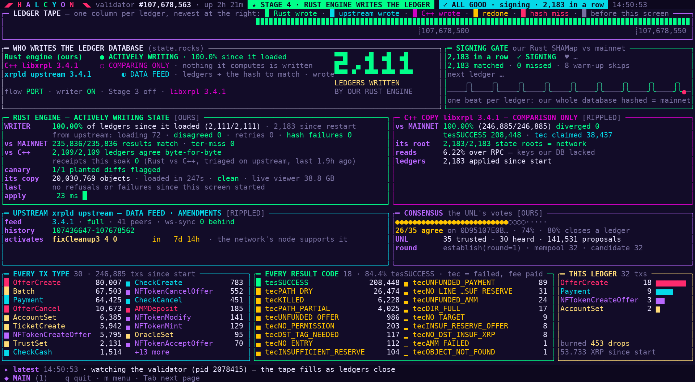
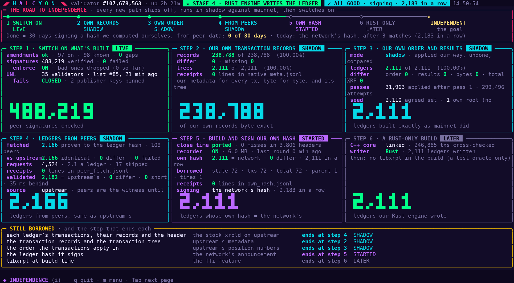

# xrpl-watch (HALCYON)

A real-time terminal dashboard for an XRP Ledger validator, written in Rust with [ratatui](https://ratatui.rs).

It was built for [xrpl-validator](https://github.com/ilubxrp589/xrpl-validator), a validator whose own Rust engine writes the ledger, and it shows that validator at work: who wrote each ledger, whether our hash matched the network's, and how far the validator is on the road to needing nobody else. It only reads; it changes nothing.





## Pages

Press `m` for the menu, a page's key to open it, `Tab` for the next page and `q` to quit.

| Key | Page | What it shows |
|---|---|---|
| `1` | Main | the ledger tape, who writes the ledger, signing, the engine |
| `i` | Independence | the road to a validator that needs no one else |
| `r` | Receipts | every difference since the validator started, fixed or open |
| `s` | System | the validator's machine and process, and the server that feeds it |
| `n` | Network | peers (addresses never shown), the upstream, consensus, how the public trackers score the validator |
| `g` | Governance | amendments: majorities, votes, what the validator is ready for |
| `d` | Deploys | what is live, the soak, the next cycle, what is waiting on the operator |
| `l` | Daily reports | every day's engineering report: pick a day, read it |

`p` pauses the screen. The screen redraws about 30 times a second, and the validator is read 4 times a second.

## Build

```sh
cargo build --release
./target/release/xrpl-watch
```

It needs a recent stable Rust (it is built with 1.94) and a terminal with 24-bit colour; `--basic` uses 16 colours instead.

## What it reads

| Setting | Default | What it is |
|---|---|---|
| `VALIDATOR_BASE` | `http://localhost:3777` | the validator's HTTP API |
| `UPSTREAM_RPC` | the validator's `XRPL_RPC_URL`, else `http://localhost:5005` | the upstream rippled/xrpld for `server_info` and `feature` |
| `SIDECAR` | `http://localhost:3779` | the dashboard sidecar (System page) |
| `SHADOW_RECEIPTS`, `WRITER_LOG`, `FIXED_RECEIPTS` | taken from the running validator's environment | the engine's receipt and writer logs |
| `TUI_FEED` | `/mnt/xrpl-data/tui_feed.json` | the deploy cycle, soak and public scores (Deploys, System and Network pages) |
| `DAILY_REPORTS` | `/mnt/xrpl-data/daily-reports` | the folder of daily `.md` reports |
| `XRPL_WATCH_HOST` | this machine's hostname | what the screen calls the validator's machine |
| `XRPL_WATCH_UPSTREAM` | from `UPSTREAM_RPC`: a private IPv4 address shows as `.` and its last number (such as `.12`), a loopback one as "the upstream", anything else as its host name | what the screen calls the upstream server |

A page whose source is missing says so and the rest keep working.

The screenshots above were taken with `XRPL_WATCH_HOST=validator XRPL_WATCH_UPSTREAM=upstream`.

## Pictures and video

```sh
xrpl-watch --once [--size 160x48] [--page NAME] [--menu]     # one frame as ANSI text
xrpl-watch --record DIR --frames N --interval S [--fps F]     # numbered frames for a video
```

`--page` takes `independence`, `receipts`, `system`, `network`, `governance`, `deploys` or `reports`; `--report DATE [--scroll N]` opens a daily report. `xrpl-watch --help` lists everything.

## History

This tool began as `tools/xrpl-watch` in [xrpl-validator](https://github.com/ilubxrp589/xrpl-validator) on 2026-10-08 and moved here, with its full commit history, on 2026-10-15.

## License

MIT, with an attribution requirement: any work that uses, copies or modifies this code must credit James Turner with a link to this repository. See [LICENSE](LICENSE).
